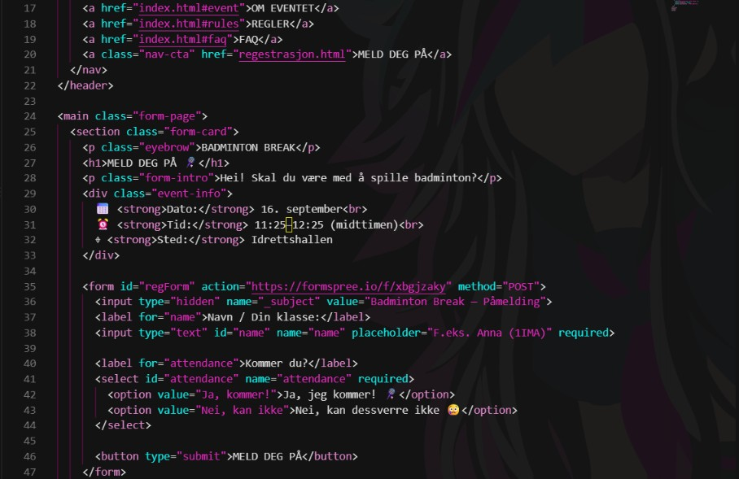

# bambinton

**Badminton Break** er en nettside for et badminton-event på Hamar katedralskole. Nettsiden gir informasjon om eventet, tidspunkt, regler, hvordan spillet fungerer og vanlige spørsmål.

## Programmeringsspråk

Prosjektet bruker:

* HTML
* CSS
* JavaScript

## Hva gjør programmet?

Nettsiden:

* viser informasjon om Badminton Break
* viser tidspunkt og sted for eventet
* viser regler for spillet
* forklarer hvordan kampene fungerer
* har en FAQ-seksjon
* har en registreringsside
* fungerer på både PC og mobil

## Hvordan starte prosjektet?

For å starte prosjektet kan du åpne `index.html` i en nettleser.

## Problemer jeg møtte

Under arbeidet oppstod noen problemer med CSS og layout. Det var blant annet nødvendig å justere størrelsen på tekst, bilder og elementer slik at nettsiden fungerte på mindre skjermer.

## Eksempel på kode

Et eksempel fra prosjektet:

